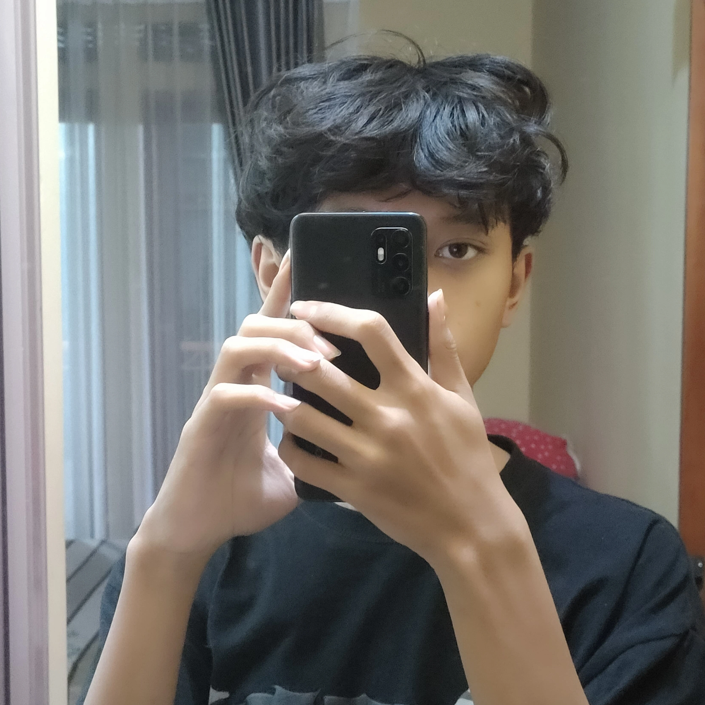

  

## Hi, I'm zahwan

  <b>Creator &amp; Tinkerer</b>  
  <code>Turning absurd ideas into real things</code>

---

##  About Me

<table>
  <tr>
    <td valign="top" width="60%">
      
I’m just a kid with ADHD (maybe lol)

      
I’m into a lot of things—photography, reading novels, and, most of all, creating new things... whatever they might be. I hate it when dozens of absurd ideas start piling up in my head; I just have to bring them to life, which is why I created this account.

      
And I’m not solely focused here—I’m also working with <b>Blender</b> and <b>CapCut</b> to make content.

    </td>
    <td align="center" valign="middle" width="30%">
      
    </td>
  </tr>
</table>

---

##  Tech Stack

  

---

##  GitHub Stats

  

  

---

##  Contribution Snake

  

